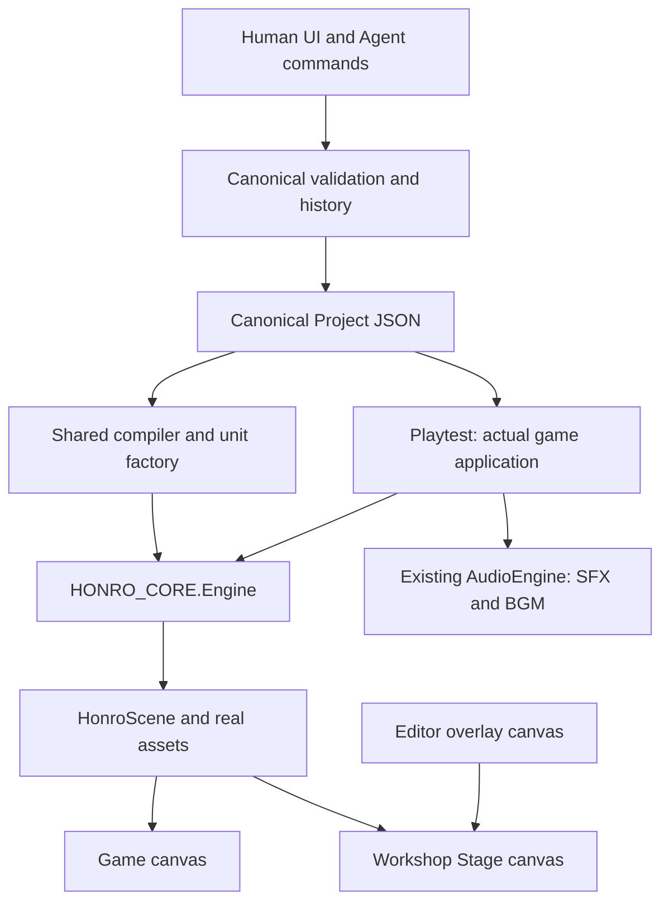

# HONRO 단일 런타임

현재 구조 기준: 2026-10-24. 변경 단위·배포·검사 범위는 [리팩토링 계획과 결과](game/docs/REFACTOR_PLAN_20261024.md)를 참고합니다. 과거 RC 문서의 숫자나 공급자 목록을 현재 실행 계약으로 사용하지 않습니다.

게임과 편집기는 같은 `HONRO_CORE.Engine`, `HonroScene`, `HonroMaps.createBattle`, `HonroUnits.create`를 호출합니다. Workshop의 별도 Stage 배경·지형·유닛 그림과 간이 플레이 물리는 제거했습니다.

## 빌드 경계

`shared/build.mjs`의 `runtimeEntries()`가 유일한 실행 목록이며 `runtimeParts()`는 native 소비자에게 같은 실행 순서의 문자열을 제공합니다. `shared/web-build.mjs`는 이 목록을 공통 ES 모듈, CSS, 캠페인 기본 정보/30장/공용 그림 라이브러리 JSON과 그래픽 자산으로 내보냅니다. Game과 Workshop Stage View는 같은 모듈 URL을 사용하고, Playtest는 콘텐츠 해시 Game 문서를 `?embedded=1`로 iframe에 직접 불러옵니다. 공개 진입 주소는 `HONRO.html`·`HONRO_WORKSHOP.html` 그대로입니다.

`web/manifest.json`이 생성 파일을 기록합니다. HTML만 복사하면 실행되지 않으므로 `web/` 전체와 기존 BGM을 같은 HTTP 경로로 배포합니다. 파일명은 콘텐츠 해시를 포함합니다. 활성 그래프와 구 클라이언트용 보존 그래프는 구분하며, 실제 성공 발행의 최근 7일 전체와 최소 최신 2개는 원래 바이트로 보존합니다. 중간 빌드 두 세대는 별도입니다. 사용하지 않는 생성물은 이 보호 범위 밖에서 정리하며, 보존 파일을 현재 로딩 목록에 추가하지 않습니다. [발행 자산 보존 규칙](game/docs/RELEASE_OPERATION_GUARD.md)을 따릅니다. 그림 라이브러리의 편집용 SVG 원문과 Canvas 벡터 트리는 JSON 안에서 함께 보존하며, 원경 SVG·타이틀 이미지는 외부 파일입니다.

모듈 로드는 `HONRO_READY` Promise로 완료를 알립니다. Workshop은 DOM 준비 후 초기화하고, iframe load 뒤 Game 준비를 기다린 후 기존 `launchMap`을 호출합니다. ACT1_FAR_DATA의 SVG 원문만 선택 로딩하며, 이 배치의 대기는 1,500ms로 제한합니다. 이는 전체 시작 시간 보장이 아닙니다. 늦게 도착한 원문은 캐시에 반영하고 generic 장면은 준비 상태 변경 시 다시 합성합니다. 현재 1–30장 sharedRest는 이미지 원경을 사용합니다. 필수 JSON·모듈·작성 데이터의 실패는 여전히 오류로 처리합니다. embedded에서는 기존 캠페인 load/persist 차단에 더해 직접 save 경로도 차단합니다.

## 작성 상태와 실행 상태

Project JSON은 작성 원본입니다. compiler는 원본을 변경하지 않고 Battle을 만들며 엔진은 Battle을 변경합니다. 편집 중에는 실제 Scene을 `dt=0`으로 렌더링하고 별도 canvas에 편집 오버레이를 그립니다. 선택·드래그·스냅은 공통 camera 변환과 geometry를 사용합니다.

인간 편집과 Agent는 같은 Project, `HonroMaps.finalize()` 검증과 undo/redo 히스토리를 사용합니다. 포인터 드래그는 라이브 미리보기 후 하나의 항목으로 저장합니다. Agent preview는 별도 복제본을 실제 Scene에 연결하고 Apply 전 원본을 변경하지 않습니다. Apply는 생성된 ID까지 그대로 반영합니다.

Playtest는 작성 데이터 복제본과 메모리 프로필을 받습니다. Stop은 iframe·오디오를 폐기하고 편집 카메라·선택·도구를 복원합니다. 게임의 JSON 가져오기도 `HonroApp.launchMap`을 사용하며, 테스트 중 저장을 차단하고 종료 시 원래 캠페인 프로필을 복원합니다. 재시도는 가져온 맵을 다시 만듭니다.

## 렌더링·성능·에셋

전장은 기존 벡터 근경과 장면별 이미지 원경을 함께 사용합니다. 승인된 캐릭터·묵종·현재 지형의 미술을 유지하며, 퇴역 이미지 지형 시범을 기본 렌더러로 되살리지 않습니다. `HonroElements.draw`로 Element Studio·썸네일·게임에 같은 요소를 그립니다. 원본 procedural landmark도 원래 Scene 메서드를 사용합니다. 새 요소의 독립 충돌 폴리곤은 실제 엔진 지형으로 컴파일하며 충돌용 그림은 중복 표시하지 않습니다. 파괴는 `sceneVersion`을 올려 캐시를 갱신합니다.

background/static world raster cache, culling, zoom별 raster LOD를 유지합니다. Geometry는 작성 변경 시 컴파일하며 매 프레임 만들지 않습니다. 사용자 명시적 간소화 외에 이관 지형 노드를 줄이지 않습니다. 이번 구조 정리에서는 캐릭터 밸런스·스킬·SFX/VFX·스토리·기본 조작을 변경하지 않습니다. 현재 Project는 Map version 6이며 캠페인 profile schema 4와 별개입니다. 세부 저장 revision은 각 이관 코드의 계약을 따릅니다. 관련 비교를 넘어 전체 게임의 성능 향상이나 30장 회귀 통과를 주장하지 않습니다.

## 실행 책임과 수정 위치

- `shared/runtime/profile-store.js`: 캠페인 저장 읽기·쓰기·오류와 load/import 이관의 공통 소유자입니다. 읽기·파싱·형식·버전·이관 실패 시 원문을 보존하고 캠페인 자동 저장을 잠급니다. 정상 진행 중 quota 쓰기 실패는 별도로 경고하며 현재 메모리 진행·내보내기·재시도를 유지합니다.
- `shared/runtime/main.js`: 앱 흐름·입력·화면 전환을 연결합니다. 아군 목록 캐시 서명은 목록 DOM의 수명에 귀속됩니다. 수련 초기화는 private `initializeTrainingBattle`이며 public `makeWorld`와 world callback 계약은 그대로입니다.
- `shared/runtime/camp-renderer.js`: 모닥불의 기존 keyed DOM 조정 책임입니다. `skill-images.js`는 이미지 요청·캐시·관찰 수명을 관리하며, 공통 DOM patch의 대체 구현을 갖지 않습니다.
- `shared/runtime/story.js`: 대사 상태와 진행 계약은 유지하고, 동일한 본문 합성·일반 페이지 마무리만 private helper로 공유합니다. staging·guide 등 실제로 다른 분기는 보존합니다.
- `shared/runtime/objectives.js`와 ObjectiveGuide: 목표의 실제 상태·표시 보강·화면별 표현은 의도된 경계입니다. 무조건 하나의 거대 함수로 합치지 않습니다.
- `shared/runtime/journey-art.js`와 휴식터 데이터: 현재 휴식터와 generic 장면의 소비 경로를 유지합니다. 10장 장식은 원본 root 이미지와 thread/root 그룹만 직접 참조하며, 옛 paintedRest 공급자를 경유하지 않습니다.

- `shared/build.mjs`의 `skillAudioData()`: 효과음 ID별 원본 bank를 하나만 허용합니다. 현재 base/weapon/arrow/thunder/bowstring 항목을 합칠 때 중복 ID는 오류로 처리하며, 옛 항목의 숨은 덮어쓰기로 현재 음원을 선택하지 않습니다.

## 보존과 삭제의 경계

이름이 오래됐다는 이유만으로 삭제하지 않습니다. 실제 실행 목록, 동적 경로, 빌드·편집기·저장 이관·관련 검사 입력을 확인합니다. 사용하지 않는 코드·원본·중간 산출물은 Git 이력으로 복구하며 런타임 폴백으로 남기지 않습니다. 현재 사용 중인 원본 이미지, 정상 이전 저장 이관, 초상화의 기본 표정 선택, 오류 안내·재시도는 퇴역 구현과 다릅니다.

`migration/legacy/`의 비교·이관 자료는 현재 런타임 목록이 아닙니다. 과거 검사와 보고서는 당시 동작의 근거이며, 오늘의 전체 검사 통과를 뜻하지 않습니다. 보호된 `web/` 발행 파일도 구 클라이언트를 위한 한시적 배포 자료이지 현재 실행의 대체 공급자가 아닙니다.
