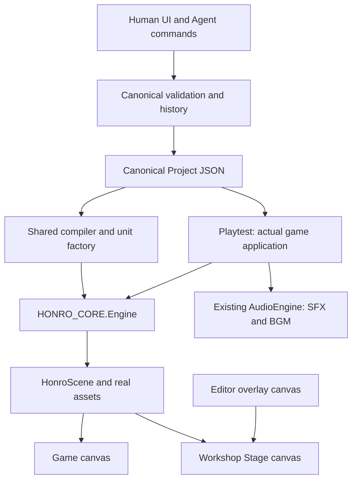

# HONRO 단일 런타임

게임과 편집기는 같은 `HONRO_CORE.Engine`, `HonroScene`, `HonroMaps.createBattle`, `HonroUnits.create`를 호출합니다. Workshop의 별도 Stage 배경·지형·유닛 그림과 간이 플레이 물리는 제거했습니다.

## 빌드 경계

`shared/build.mjs`의 `runtimeEntries()`가 유일한 실행 목록이며 `runtimeParts()`는 native 소비자에게 같은 실행 순서의 문자열을 제공합니다. `shared/web-build.mjs`는 이 목록을 공통 ES 모듈, CSS, 캠페인 기본 정보/30장/공용 그림 라이브러리 JSON과 그래픽 자산으로 내보냅니다. Game과 Workshop Stage View는 같은 모듈 URL을 사용하고, Playtest는 콘텐츠 해시 Game 문서를 `?embedded=1`로 iframe에 직접 불러옵니다. 공개 진입 주소는 `HONRO.html`·`HONRO_WORKSHOP.html` 그대로입니다.

`web/manifest.json`이 생성 파일을 기록합니다. HTML만 복사하면 실행되지 않으므로 `web/` 전체와 기존 BGM을 같은 HTTP 경로로 배포합니다. 파일명은 콘텐츠 해시를 포함하고 빌드는 이전 manifest가 소유한 낡은 생성물만 정리합니다. 그림 라이브러리의 편집용 SVG 원문과 Canvas 벡터 트리는 JSON 안에서 함께 보존하며, 원경 SVG·타이틀 이미지는 외부 파일입니다.

모듈 로드는 `HONRO_READY` Promise로 완료를 알립니다. Workshop은 DOM 준비 후 초기화하고, iframe load 뒤 Game 준비를 기다린 후 기존 `launchMap`을 호출합니다. 원경 SVG 원문은 로더가 미리 보관하여 쉼터의 동기 SVG 합성도 같은 경로를 사용합니다. embedded에서는 기존 캠페인 load/persist 차단에 더해 직접 save 경로도 차단합니다.

## 작성 상태와 실행 상태

Project JSON은 작성 원본입니다. compiler는 원본을 변경하지 않고 Battle을 만들며 엔진은 Battle을 변경합니다. 편집 중에는 실제 Scene을 `dt=0`으로 렌더링하고 별도 canvas에 편집 오버레이를 그립니다. 선택·드래그·스냅은 공통 camera 변환과 geometry를 사용합니다.

인간 편집과 Agent는 같은 Project, `HonroMaps.finalize()` 검증과 undo/redo 히스토리를 사용합니다. 포인터 드래그는 라이브 미리보기 후 하나의 항목으로 저장합니다. Agent preview는 별도 복제본을 실제 Scene에 연결하고 Apply 전 원본을 변경하지 않습니다. Apply는 생성된 ID까지 그대로 반영합니다.

Playtest는 작성 데이터 복제본과 메모리 프로필을 받습니다. Stop은 iframe·오디오를 폐기하고 편집 카메라·선택·도구를 복원합니다. 게임의 JSON 가져오기도 `HonroApp.launchMap`을 사용하며, 테스트 중 저장을 차단하고 종료 시 원래 캠페인 프로필을 복원합니다. 재시도는 가져온 맵을 다시 만듭니다.

## 렌더링·성능·에셋

기존 Scene, art-dark, party v006을 유지합니다. `HonroElements.draw`로 Element Studio·썸네일·게임에 같은 요소를 그립니다. 원본 procedural landmark도 원래 Scene 메서드를 사용합니다. 새 요소의 독립 충돌 폴리곤은 실제 엔진 지형으로 컴파일하며 충돌용 그림은 중복 표시하지 않습니다. 파괴는 `sceneVersion`을 올려 캐시를 갱신합니다.

RC21의 background/static world raster cache, culling, zoom별 raster LOD를 유지합니다. Geometry는 작성 변경 시 컴파일하며 매 프레임 만들지 않습니다. 사용자 명시적 간소화 외에 이관 지형 노드를 줄이지 않습니다. 캐릭터 밸런스·스킬·SFX/VFX·스토리·기본 조작과 저장 revision 20은 유지했습니다. Map version 3은 캠페인 진행 저장 버전과 별개입니다.
