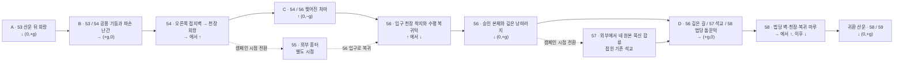

# 무명사 연결과 축 중력 설계

[P00/P10 기록](README.md) · [추가 경계 검수 계약](../ACT6_MUMYEONGSA_SEAM_CHECKS_20261125.md) · [공통 축척 문턱 단면](concepts/threshold-scale.svg)

## 내부 연속 동선

- 53의 A는 익숙한 바닥·보·문폭을 먼저 가르친다. 53 출구의 짧은 B 방에서 오른쪽 기둥의 면이 접지면이 된다. 그 면에 발이 닿은 뒤 장 소유권을 넘긴다. 54의 첫 화면에서 같은 기둥의 결, 파손 난간, 발 위치를 읽을 수 있게 한다.
- 54의 주 교전은 세로 벽, 천장으로 이어지는 경첩실, 머리 위로 올라가는 진목 회랑으로 상승한다. C에서 올려다보던 처마 밑면에 실제 착지해 가로로 열린 파손부를 건넌다. 55는 바깥의 세 사람으로 시점이 이동한다. C의 담허·진목·중력·방향은 다음 56 입구까지 이어진다.
- 56의 시작에만 이음용 짧은 천장 착지 구간을 두고 넓은 턱에서 아래 방향으로 복귀한다. 현행 `A-upper-veranda` 발점 (928,1136)을 정상 방향 복귀의 첫 검증점으로 둔다. 승인 본체의 11개 지형 레코드와 `ch06-v5-local-native-art` 725면, 좌측 수직 낭떠러지와 그 하부 여백을 보존한다. 첫 가름진·역류·대피 스트립·`E-joined-ordinary-floor`의 현행 끝 목표 (6400,3368)는 보존 앵커다. D용 겹침 실은 끝 목표 확인 뒤에만 연다. C·D 삽입 위치는 별도 방을 기존 통로에 정렬하는 작업 가설이다. 실제 몸체 또는 낭떠러지 공간을 침범하면 다시 배치한다. [56 패킷과 실제 시작 화면](baseline/screens/stage-56.webp)
- 57의 기존 접힌 석교는 D로 들어가는 바깥 갈래다. 세 사람이 담허의 육신을 회수한 뒤 모두 기존 발판에서 이어진 대기 마루를 지나 문턱에 직접 들어간다. 56 내부 갈래와 한 문턱으로 합류한다. 58에는 같은 네 사람과 같은 파손이 남는다. 58 입구에는 대도사가 아직 없다. 상·하 두 교전 접근 길을 쓰도록 법당 벽·천장·바닥의 단면을 다르게 읽히게 한다. 보스 방 밖 낮은 마루는 귀환을 위한 정상 아래 방향 복귀로 이어진다.
- 58 출구 R은 59의 도착 산문에 같은 돌·목구조 단면을 사용한다. 59 진입부의 방패선 접근은 그대로 이어가고, 전선/보스 리그 및 기존 후일담의 장면 소유권을 유지한다.

## 경계 선언 초안

월드 +X가 오른쪽, +Y가 아래다. 폭은 직교 이동 단면 양쪽 충돌 사이의 순수 여유다. B·C·D·R은 이 문서의 앵커 ID이며 새 편집 자산이나 런타임 식별자가 아니다. 좌표는 앵커 로컬 좌표로 둘레와 발을 비교한다. 각 장의 실제 월드 원점과 통로 트리거는 다음 단계에서 맞춘다. 바닥 구간은 접촉 면의 법선을 중력 반대 방향으로 기록한다.

| edgeId | from → to | landmarkId | approach | sharedColliders | clearWidth | activeGravity | nextSpawn | allowedHazard |
|---|---|---|---|---|---:|---|---|---|
| A | 53 산문 → 53 뒷회랑 | `mumyeongsa-inner-gate` | +X, 산문 돌단 넘어 마루 | 마루 윗면 y=0, 들보 아래 y=−208 | 208 | (0,+g) | 기존 시작 발점 x=425의 동일 접지에서 회랑으로 들어감 | 회랑 안 없음 |
| B | 53 뒤 회랑 → 54 입구 | `mumyeongsa-broken-rail` | 벽을 따라 −Y, 회전 전후 대기 공간 | 문틀 측벽 x=0, 대향 면 x=−224, 파손 난간 외형·가림 분리 | 224 | (+g,0) | 경계선 y=0에서 수신 y=−16, 발 x=0, 법선 (−1,0), 이동 접선 방향 보존 | 문턱 안 낙차 없음. 사선은 받침 뒤에서 열림 |
| C | 54 처마 끝 → 56 입구 | `mumyeongsa-torn-eave` | +X, 처마 밑면 발을 붙인 채 이동 | 천장 접촉 y=0, 대향 턱 y=236 | 236 | (0,−g) | 경계 x=0에서 수신 x=16, 발 y=0, 법선 (0,+1). 짧은 수신 턱 이후 56 정상 접지로 전환 | 짧은 정상 중력 복귀 구간에 경고와 회수 턱. 본체 낭떠러지는 기존 예외 |
| D | 56 깊은 길 또는 57 석교 → 58 문턱 | `mumyeongsa-hall-sill` | −Y, 두 갈래가 넓은 공통 대기 마루를 거쳐 벽에 올라섬 | 큰 돌문턱과 각진 기둥, 쌍들보 목재, 선명한 우측 면 x=0, 대향 면 x=−408 | 408 | (+g,0) | 경계 y=0, 58 수신 면 x=0의 4개 차례 발점 y=−24/−96/−168/−240, 모두 법선 (−1,0). 슬롯 인계는 해당 배우가 밟은 위치와 대응 | 문턱에 적 사선·전환 피해 없음 |
| R | 58 복귀 마루 → 59 교각 | `mumyeongsa-return-gate` | +X, 본래 바닥축에 복귀해서 산문 돌단 통과 | 산문 석단 윗면 y=0, 지붕 내부 y=−248, 네 사람 대기 길이 544 | 248 | (0,+g) | 경계 x=0, 수신 마루 y=0, 같은 법선 (0,−1), 59 시작 편대 배치로 갈라지기 전에 네 발점 검증 | 문턱 안 없음. 산문 밖에서 교각 위협 시작 |

가장 큰 현재 캐릭터 기본 접지 높이와 반경은 네 영웅 모두 h=92, r=22 world다. 나란히 선 배우 발점 72 간격은 각 몸 폭 44에 28의 간격을 둔다. 56·57·58 배우와 개별 리그가 쓰는 회전 바디의 실제 확장 폭은 구현에서 캐릭터별로 다시 시험한다. 도표의 영웅은 충돌 외곽의 비교 기준이다. 장식은 원경·접지용 구조·전경 가림을 세 층으로 저작하며, 문턱의 시야 및 피격·출입 방향에서 가림을 제거한다. 좌·우·위·아래에는 돌과 목구조 이어붙임을 남기고, 설계된 56 낭떠러지 벽면의 가림 및 왕복 턱 효과를 별도로 검수한다.

## 연속성과 입력 증거 요구

| 게이트 | 현행 근거 | 개정 구현의 통과 증거 |
|---|---|---|
| 54 진목 및 54→55→56 | [54 owner](../../../../shared/runtime/stage54-pilot-owner.mjs) · [55 live 진입](../../../../shared/runtime/stage55-entry.inc.js) · [boundary codec](../../../../shared/act6-boundary/chapter-boundary.mjs). 현행 M09는 L `mid-contact`, 사수 x=2334~2340. 실제 말뚝 y=2930 및 N→L→C→L 접지가 각각 정상 live 55와 저장 계약에 들어간다. | 54의 새 축 접지 좌표·법선에 실제 M09 투사, 충돌 ID·shot·주인·발점·경로 로그가 일치. C의 마지막 축과 저장된 담허, 55 바깥 세 사람, 56 천장 수신 상태를 모두 비교. 정상 입력으로 54→55→56, 별도 빈 Chromium 컨텍스트에서 각 체크포인트를 다시 읽어 같은 배우·HP·장비·불변 스탬프 확인. |
| 57→58 네 사람 수신 | [boundary codec](../../../../shared/act6-boundary/chapter-boundary.mjs) · [58 adapter](../../../../shared/runtime/stage58-normal-adapter.mjs). 현행 57 `local-07-08-exact-receiving-slice`에 4명 접지, 기존 변환 x−3200, y+758. 현행 58 isolated fixture는 4명이 `local-lower-08-body`에 서 있다. | 57 4개 실제 입력·좌표와 D의 공용 수신 면, 각 58 초기 발점·법선·중력·고유 배우/장비/HP를 영상·로그에서 짝짓는다. 네 사람이 먼저 접촉을 완료하고, 58 경계 저장을 빈 컨텍스트에서 다시 읽는다. 곽진의 비전투 소유권도 유지한다. |
| 58→59 수동 산문 | [58 return UI](../../../../shared/runtime/stage58-normal-entry.inc.js) · [59 entry](../../../../shared/runtime/stage59-normal-entry.inc.js). 현행 이동 순서 조정에 `noncombatReturn`이 있고 다음 장에서 내정 앉힘점을 사용한다. | 실제 입력으로 58의 넷이 R에 발을 디딘 프레임과 59 첫 프레임을 같은 배율·앵커 방향에서 비교. 발·지지·중력·같은 파손 석단을 영상과 shot/목표 로그로 대조. 클릭은 이동 차례 조정에 한한다. 정상 아래 방향 복귀 이후의 59 산문에서 외부 편대가 흩어진다. |
| 첫 측면 중력 교전 | [현행 몸체 solve](../../../../shared/engine/src/engine.ts) · [58 포탄 전용 지역](../../../../shared/runtime/stage58-owner.mjs). 일반 지원 및 착지 판정은 stock +Y 기준이다. | 60 Hz와 120 Hz 각각, 영웅과 교전 적이 같은 합법 접지 또는 명확한 정상 축 표면에 서고, 이동/점프 후 착지와 적의 실제 행동을 기록한다. 실제 포격 1회를 예측 선·발사 각·가속 방향·지형 접점과 대조한다. 피격·넉백·리스폰 및 UI/E 입력을 반복한다. 카메라 회전 감소 모드에서도 월드 축이 같다. |

경계 비교에서 양쪽 collider 단면·문폭·첫 발점 최대 오차 4 world px, 통로 내 가시적 단절·막다른 벽 0, 모든 의도한 입구 유효 통과를 확인한다. 좌표계 전환만으로 기존 바닥에 다시 앉는 경우, 적이 벽과 떨어져 있거나 표면을 못 읽는 경우, 포탄만 축이 바뀐 경우는 각 항목 실패다. 첫 화면에서 양쪽의 같은 부품이 아직 보이도록 겹침 방에 연결구를 둔다. 외부 돌단과 혼줄에 대한 서사 소유권은 기존 장 진행 이름과 따로 검증한다.
