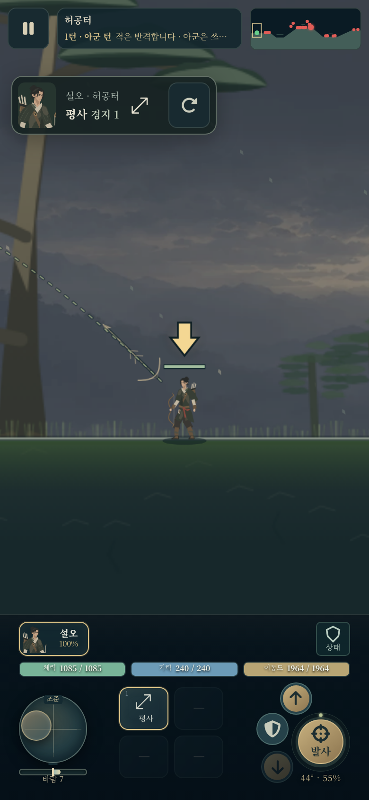
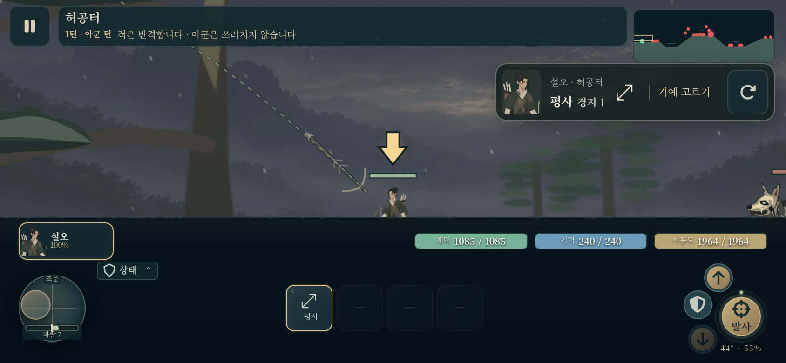

# 조이스틱 최종 검수 원본 증거

부모의 실제 화면 검수를 위해 로컬 최종 증거에서 아래 5개 파일을 바이트 변경 없이 복사했다. 구현은 `1a808154`, 브라우저 검사/문서는 `28099b13`이다. 기능 변경이나 전체 재검사는 하지 않았다. master/Pages 반영은 부모 검수까지 보류한다.

- [최종 검수 문서](review.md): 의도 판정/방향 전환/생명주기 3개 집중 검수와 종합 결과.
- [최종 입력 trace](input-trace.json): 브라우저 판정 255개, 상태 429개, PointerEvent 614개. Chromium CDP 합성 터치이며 실제 폰/Safari 검증이 아니다. targeted cancel은 문서에 구분한 dispatchEvent 합성 입력이다.
- [390×844 CSS px 원본 PNG](mobile-390-aim-only.png): DPR 2, 이미지 780×1688px.
- [844×390 CSS px 원본 PNG](mobile-844-aim-only.png): DPR 2, 이미지 1688×780px.
- [빌드/소스 provenance](provenance.json): 검증 당시 소스와 생성 문서 SHA-256.

두 PNG를 직접 다시 열어 확인했다. 7 CSS px 모드 라벨은 조이스틱 상단 안에 있고 노브의 현재 위치·이동도·발사/점프 버튼을 가리지 않는다. 라벨은 `pointer-events:none`이며 기존 터치 영역/크기를 바꾸지 않는다. 이 화면에서는 핵심 조작을 방해하는 겹침이 없다. 문구는 작으므로 보조 표시 수준이며, 실제 폰에서의 읽기 편함과 손가락에 가린 상태는 미검증이다. 실제 폰·iOS/Safari·OS 회전 검증을 합성 브라우저 검증과 구분한다. 가로 화면의 기존 HUD/캐릭터 하단 가림은 입력 변경 범위 밖이라는 종합 검수 기록도 유지한다.

원본 검수 문서가 언급하는 320/360 PNG, 실행 로그, 이전 검사 fixture 실패 trace와 verified-build 압축본은 `_local/reports/joystick-intent/`에 남아 있으며 이 최소 묶음에는 포함하지 않았다.

## 원본 동일성

| 파일 | SHA-256 |
|---|---|
| [review.md](review.md) | `6432f9897108173d96830c549819823d5f6c6bd7f3a7f354db8c414865b83262` |
| [input-trace.json](input-trace.json) | `1b320e75cbdfe1a25290b516dd70d974d52e822566b98d0a516aea29f964bae1` |
| [mobile-390-aim-only.png](mobile-390-aim-only.png) | `d2e9e50694f1d678e6f9eae84e140fa51aa621c8280814c0583641e27cd31b0b` |
| [mobile-844-aim-only.png](mobile-844-aim-only.png) | `a02859f994c899a121833630f622510f19c87c82ddca7896ea4c46e1e07b9101` |
| [provenance.json](provenance.json) | `0fd1ae1d8fea0e3e38d99e0e92bcc5c5874cff58863585e66ba6ba2346e261f1` |

## 대표 원본 화면

