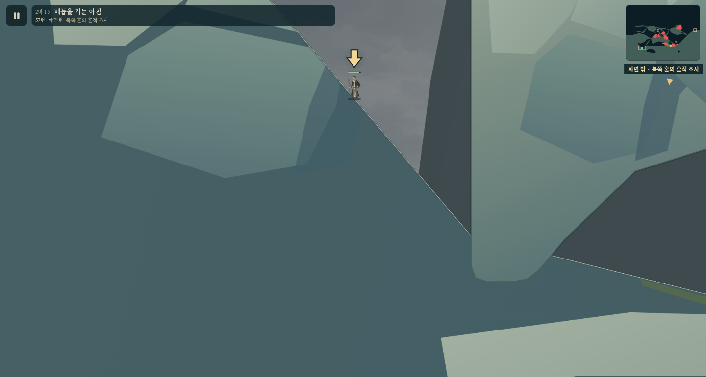
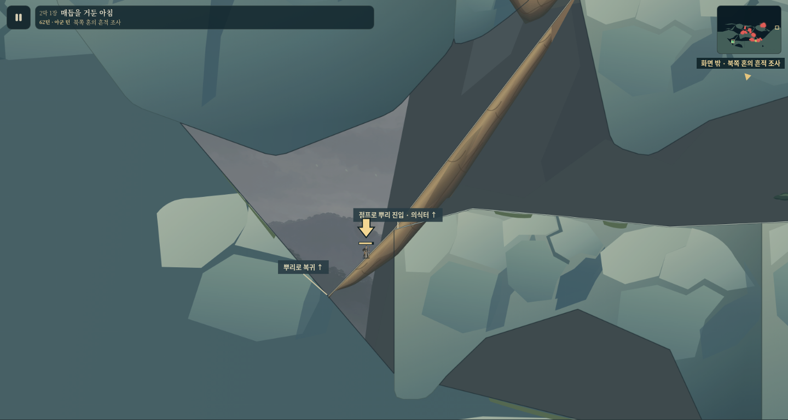

# 11장 하부 접근성과 추락 복귀 검수

**추락받이의 실제 갇힘을 기존 뿌리의 짧은 하부 연장으로 해결했다.** rim만 제거했던90d77eed는 부모가 승인하지 않은 이전 후보다. 현 후보는 실제 서쪽/동쪽 실패 저장을 이어서 검사해 두 경우 모두 의식 암대에 복귀했다. master/Pages는 계속 부모 검수 대기다. 이미지 생성·첨부403 우회·적 추가·자동 워프는 없다.

기준 소스는90d77eed(최신 master bafc275c를 포함)이며 수정/검수 소스는 **0744c66f60f95520acd8a947544e3d8086c956d9**다. 촬영 당시 작업 소스·검사 소스의 SHA256이 이 커밋과 일치함을 [provenance](evidence/provenance.json)에서 확인했다. 아래 PNG/trace와 원래 실패 체크포인트를 저장소에 보존한다. 원 첨부 대응은 [부모의 직접 관찰 출처](parent-visual-evidence.md), 이전 진입/용도 검수는 [초기 보고서](initial-review.md)에 따로 남겼다.

## 지형 대응과 용도

| 화면 부분 | ID / 좌표 | 실제 용도 |
|---|---|---|
| 위의 큰 의식 암대 | `rv-ritual-buttress`, x5400–9500, y6710–7600 | 필수 의식/전투 장소 |
| 왼쪽 뿌리 | `rv-root-west-return`, 기존 (4000,8900)→(5400,7080) | 서측 회귀. 현행은 하부를 **(3500,9411.76)**까지 연장 |
| 긴 하부 서측 암대 | `rv-lower-west-shelf`, x4000–6800, y8740–8900 | 선택 퇴로/회귀. 별도 전투/보상 목적은 추가하지 않음 |
| 그 오른쪽 주민 암대 | `rv-lower-refuge-rock`, x6800–11300, y8600–8850 | 주민 x9700의 구조 접근/기존 교전 |
| 더 낮은 바닥 | `act2-floor`, 서쪽 x2300–4000, y8000–10000 등 | 추락받이. 주동선/보상 길은 아니지만 정상 복귀 접속을 보장 |

주민 구역 진입은 동측 뿌리 끝을 돌면 되며 서쪽 긴 암대를 거칠 필요가 없다. 이전 실제 R41→44 진입 [trace](evidence/entry-trace.json), R54→59 선택 회귀 [trace](evidence/optional-return-trace.json)를 보존했다. 주민 구역의 실제 도달 pose에서 M01은 기존 적에게85피해/기력0소모였지만, 서측 중앙에서 가까운6적의 기본파 유효 사선은 없었다([기록](evidence/rescue-tactics.json)). 서측 암대를 공격 명당이나 구조 후 출구 지름길로 주장하지 않는다.

## 실패 원인: 경사/예산이 아닌 머리 높이와 벽

원래 실제 실패 상태는 담허 (2486.354,8219.240), 몸 높이92, HP692, 기력245, 이동력471.572/1588, 적37명 생존이었다([서측 원본 저장](evidence/failed-west-checkpoint.json.gz)). 낙하 전 HP745에서53피해를 받은 상태를 사용했다.

- 서측 암괴 밑면 y8126.856과 바닥 y8219.240 사이 통로는92.384px다. 몸 높이92에 남는 여유가0.384px여서 더 왼쪽으로 걸으면 머리/몸통 충돌 검사가 막는다. 바닥 경사1.17647은 허용1.35 이내다. 이 자리에서 실제 점프 상승은0.953px뿐이었다.
- 같은 자원으로 열린 x2992 바닥에서 기본 점프는213.615px 상승했다. 점프 자체나 예산이 고장 난 것이 아니다.
- 동쪽으로 실제 걸어가면 x3993.583,y9992.451에서 암대 벽에 막힌다. 상면 y8900까지1092px를 올라야 해 기본 점프로 넘지 못한다. 점프3회 후에도 이동력이908.061 남았다([동측 실제 실패 저장](evidence/failed-east-checkpoint.json.gz)).
- 이 도달 가능한 바닥 주머니의 서쪽은 천장 간격이 닫히고 동쪽은 낮은 바닥 아래까지 이어지는 암대 벽이다. 두 방향의 정상 보행/기본 점프가 실제로 실패했으므로 밝은 rim 제거만으로 종료할 수 없는 softlock이었다. 모든 장의 모든 낙하 위치에 대한 판정으로 확대하지 않는다.

[실제 진단 trace](evidence/floor-diagnosis.json)와 [원본 물리 지형](evidence/floor-geometry.json)을 보존했다. 진단은 지형 수정 전90d77eed에서 실패 체크포인트를 이어 실행한 것이다.



## 최소 수정과 실제 복귀 결과

같은 `rv-root-west-return` one-way 뿌리의 시작점만 (3500,9411.7647)로 내렸다. 추가 구간은 가로500/상승511.76, 경사1.02353으로 일반 보행 범위다. 기존 상부의 다섯 보행 꼭짓점은 정확히 유지한다. 길어진 뿌리의 배/수피는 기존 공통 가지 제작과 stage11 재질 렌더러가 만든다. 다른 지형30개, 원래52적+주민 혼1, 이벤트, marker, 장식, 환경, Library와 다른29장은 그대로다.

복귀는 바닥 x3490→기본 점프로 새 기부 x3540→x4000의 기존 암대 접점→기존 회귀 점프 x4030→4080→의식 암대다. 첫 재검사에서 x4000 뒤에 서측 암대가 발을 잡는 것을 확인해, 두 번째 점프를 선언과 입력 모두에 명시했다. 연결 선언만으로 통과시키지 않았다.

| 실제 입력 구간 | 시작→종료 | 일반 자원/결과 |
|---|---|---|
| 서측 실패 체크포인트 | R59 (2486.35,8219.24) → R62 (5488.73,7052.11) 의식 암대 | 점프2회, 이동력 갱신 대기3회, 이동력 약4800.79사용, 수평이동3002.37. HP692/기력245/적37 유지 |
| 동쪽 벽 실패 체크포인트 | R61 (3993.58,9992.45) → R64 (5488.07,7052.32) 의식 암대 | 점프2회, 갱신 대기3회, 이동력 약4129.02사용, 수평이동2477.86. HP692/기력245/적37 유지 |

[서측 trace](evidence/west-trace.json), [동측 trace](evidence/east-trace.json)에 모든 지점의 support/라운드/자원과 wait/jump 입력을 남겼다. 적과 다른 동행도 실제 턴을 진행하며 일반 대기로만 이동력을 갱신한다. fixture 난이도는 원래 기록의 **explorer**이며 무제한 이동/기력·아이템·HP 보정은 없다. 전체59턴을 반복하지 않았다.

기존 암대/상부 회귀 뿌리에는 서측 R61(2라운드 뒤), 동측 R62(1라운드 뒤)에 재접속했다. 표의3라운드는 거기서 중간 의식 암대까지 완전히 올라간 총비용이다. 수십 턴을 다시 진행하거나 더 먼 반대편 능선을 순회하는 탈출로가 아니다.

회귀 테스트는 새 제작 원본에서 컴파일한 뿌리 record만 원래 실패 저장의 충돌/월드 뷰에 재적용한다. **이는 테스트 전용 지형 fixture 어댑터**이며 인물/HP/MP/이동력/아이템/적/임무는 바꾸지 않는다. 실제 위치로 돌아간 척하는 좌표 보정은 없다. [검사 소스](../../../../tests/stage11-fall-recovery.mjs)가 초기 인물 전원/자원 동일성을 단언한다. 시작/도착 준비 상태도 [서측](evidence/west-initial.json.gz), [서측 도착](evidence/west-ritual.json.gz), [동측](evidence/east-initial.json.gz), [동측 도착](evidence/east-ritual.json.gz)으로 보존한다.

일반 게임 Continue에는 이 어댑터를 넣지 않는다. 장별 map revision11=1/geometry7로 옛 전투만 같은 장에서 재시작한다. 성장·XP/SP·수련·장착·완료/보상 장부의 보존, 같은 revision 전투 인물 보존, Workshop 제외를 실제 생산 App 경계에서 확인했다. 낙하마다 무손실 워프시키거나 전투 중 위치를 강제 이동하는 구현이 아니다.

## 집중 검수3회와 최종 종합

1. 정상 접근성/연속성: [하부 기부](evidence/focus1-new-root.png). 실제 실패 상태에서 이동해 새 뿌리에 착지한 R60이다. 두 native 입력 경로가 기존 낙하 피해를 유지한 채 복귀했고, 생산 Game에서도 Ctrl/방향키로 두 접점을 따로 통과했다([브라우저 입력](evidence/browser-capture.json)).
2. 용도/전략: [의식 암대 재합류](evidence/focus2-restored-ritual.png). 실제 R62 도착이며 기존 전장으로 다시 합류한다. 이 뿌리의 효용은 막힌 저장/동행을 일반 자원으로 회수하는 것이다. 깊은 바닥을 새 교전 장소로 채우거나 서측 우회를 필수 목표로 만들지 않는다.
3. 시각적 길읽기/모바일: [390×844 viewport 접점](evidence/focus3-mobile-contact.png). 처음에는 새 표식이 인물 몸/선택 화살표에 겹쳐 위/왼쪽으로 옮겼고, 화면 가장자리에 걸친 다른 표식은 출력하지 않아 잘린 글자를 없앴다. 새 뿌리는 실제 바닥에 닿고 밝은 보행면은 접속 뿌리에만 있다.
4. 최종 종합: [전체 접속](evidence/final-recovery-overview.png). 바닥→짧은 연장→기존 암대/점프→상부 회귀 뿌리가 연결된 실제 지질/목재 지형으로 읽힌다. 최종 소스의 원본 PNG를 직접 열어 확인했다. 어두운 추락받이와 실제 회귀면을 구분하며, 원래 각진 암괴의 큰 미술 자체는 광범위하게 다시 그리지 않았다.



## 적수 역사·검사·한계

기존 tactics 테스트의45명 기대값은 복원된 초기44적+주민 혼1을 가리킨다. 이후 `8fd180796c06c729e9eac369217803cf0a394d46`의 밀도 개편이8명을 추가해52+1=53이 됐다. 그룹 변화는 west-knot5→7, ritual7→9, refuge-mouth5→6, refuge-east3→4, east-overwatch8→10이다([정확한 역사 비교](evidence/enemy-count-history.json)). 이번 작업에서 적은 추가하지 않았으며 과거 테스트의45 숫자를 임의 수정하지 않았다. 그 테스트는 현재 전술 합격 근거가 아니다.

재현 순서:

```sh
node tests/stage11-fall-recovery.mjs
npm run build
python3 -m http.server 8855
# 별도 터미널
python3 tools/testing/stage11-lower-route-browser.py
```

통과: 새 author 재현/두 번 적용 동일성, 두 실패 체크포인트 회귀, stage11 구전투 restart 보존/동일 revision/Workshop 경계, 기존 campaign-map-revision8그룹, web-split248파일, landscape-art 순수성/캐시, Chromium4검수 화면+실제 키보드2접점·pageerror0·렌더 전후 battle/profile.heroes 불변. source isolation은 stage11의 root1개와 관련 공간/판본 메타데이터만 바뀜을 대조했다.

한계: 사용자 원 첨부는 직접 열지 못했으며 부모 관찰을 별도 출처로 둔다. 전체 캠페인/전체59턴 재완주, 모든 동행/빌드의 정상 플레이, 모든 낙하 위치, 실기기/Safari는 이번 증거가 아니다. 실제 진단/회귀 fixture의 난이도와 지형 재적용 범위를 숨기지 않는다. 최종 master 병합/Pages 배포는 미실행이다.
