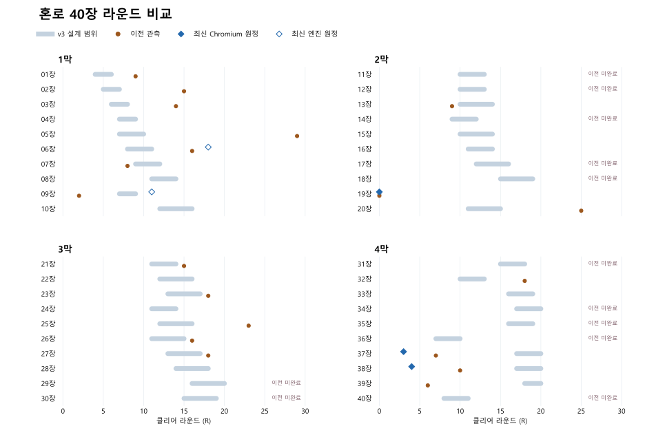

# 40장 라운드 재검수 · 2026-11-11

기준 master와 기존 공개판은 `08d56a865`였다. v3 원문 3033행의 원정 난이도(`story`)를 비교 기준으로 삼았다. 전술(`normal`) 및 초기 장의 버전·세팅 미확정 관측은 이전 기록에 남겼다. 라운드는 결과값이며 개인 행동·처치·교전 수는 별개다. 19장의 엔진 초기 라운드 번호는 1이고 실제 전투 라운드는 0이다. [v3 기획 원문](../planning/new-version-20261106/HONRO_40_STAGE_CRITERIA_v3.md)

원래 전체 검수 원시 로그는 확보하지 못했다. 이전 열은 첨부 지시의 수치이며, 수치가 빠진 완료 기록은 공란이다. 이전 미완료 12장은 결과 라운드를 추정하지 않았다. 최신 열은 이번에 끝까지 완료한 원정 검수만 싣고, 브라우저 입력과 엔진 조작을 표시했다. 엔진 구간 검사와 체크포인트 검증은 비고에 적었다. 사람 플레이타임으로 환산하지 않았다.

| 통합 장 | 스테이지 | v3 목표 R | 이전 관측 R | 최신 완료 R | 상태·근거 |
|---:|---|---:|---:|---:|---|
| 01 | 연목 고갯길 | 4–6 | 9 | — | 기존 튜토리얼과 동선 유지. 전체 재측정 없음. |
| 02 | 상여 위의 높은 길 | 5–7 | 15 | — | 기존 하강·도로 연결과 옛 저장 검사를 통과. 전체 재측정 없음. |
| 03 | 나루의 남은 장부 | 6–8 | 14 | — | 이전 장승 HP 1025→652와 이동 막힘 수정 확인. 추가 조정 보류. |
| 04 | 문 밖에 남은 사람들 | 7–9 | — | — | 이전 수치 미전달. 최신 완주 미측정. |
| 05 | 폭포 틈의 한 발 | 7–10 | 29 | — | 결박목 HP 520→320. 원정 Lv4 최초 완료·모집 보상 조건과 계획 Lv5·XP 2,466 모두 상층 유효타 5→3. 입구 시도는 전후 20R 패배, 별도 수정 후 13R 패배. |
| 06 | 끊어진 나무다리 | 8–11 | 16 | 18 · 엔진 | 원정 Lv5 저장에서 1회. 휘겸 출구 도달 R5, 마지막 필수 장승 R18, 동행 3명 생존 및 운반꾼 HP 730. 후열 합류와 보스 교전을 추가 비교할 필요가 있다. |
| 07 | 살아 있는 사람을 꺼내는 법 | 9–12 | 8 | — | 1R 차이. 최신 완료 R 미확정. |
| 08 | 돌아오는 빈 상여 | 11–14 | — | — | 이전 수치 미전달. 최신 완주 미측정. |
| 09 | 바람 없는 마당 | 7–9 | 2 | 11 · 엔진 | 원정 11R·전술 21R 엔진 검수 각 1회. 원정 최초 받이진 R7, 동행 3명 생존, 적 사망 8(적끼리 1), 피격 1,483. 다음 장 및 Continue 확인. 2R 미재현. |
| 10 | 소단 — 놓지 못한 밤 | 12–16 | — | — | 이전 수치 미전달. 최신 완주 미측정. |
| 11 | 매듭을 거둔 아침 | 10–13 | 미완료 | — | 이전 17R 정산 중단. 분리 세션에서 저장 실패 복구 확인. 원래 완주 R 미확정. |
| 12 | 돌아오는 산길 | 10–13 | 미완료 | — | 같은 동행 왕복 및 Continue 확인 이력. 전체 완주 R 미확정. |
| 13 | 숨은 석문 | 10–14 | 9 | — | 현행 목표 회귀 검사 통과. 최신 완료 R 미확정. |
| 14 | 해가 닿지 않는 마을 | 9–12 | 미완료 | — | 선행 대사와 소단 분리 입력 확인 이력. 전체 완주 R 미확정. |
| 15 | 물 아래의 길 | 10–14 | — | — | 이전 수치 미전달. 최신 완주 미측정. |
| 16 | 잠운사 | 11–14 | — | — | 이전 수치 미전달. 최신 완주 미측정. |
| 17 | 두드리는 벽 | 12–16 | 미완료 | — | 체크포인트 이후 철수·정산 확인 이력. 전체 완주 R 미확정. |
| 18 | 묵종 | 15–19 | 미완료 | — | 관찰된 Chromium 오류 9는 원인 미확인. 짧은 발사 확인 이력. |
| 19 | 종 안의 사람들 | 0 | 0 (표시 1) | 0 · Chromium | 원정 계획 진입 Lv17·XP 76,952. Chromium 입구부터 결과창까지 정상 이동·대화 1회씩. 기존 표시 1턴, 새 결과·저장 0턴. |
| 20 | 다시 하늘 아래 | 11–15 | 25 | — | 안전한 탈출 구간 호위 이동력 600→1000. 동일 시작점 물리 이동 5→3 라운드. Chromium 준비 저장 R19에서 실제 부축 이동 예산 600 초과 확인. 전체 라운드 미확정. |
| 21 | 성문 아래 | 11–14 | 15 | — | 기존 구조·후일담 목표 검사 통과. 최신 완료 R 미확정. |
| 22 | 옛 장부 | 12–16 | — | — | 이전 수치 미전달. 최신 완주 미측정. |
| 23 | 사라진 짐 | 13–17 | 18 | — | 기존 호위 목표 검사 통과. 최신 완료 R 미확정. |
| 24 | 휘겸의 문장 | 11–14 | — | — | 이전 수치 미전달. 최신 완주 미측정. |
| 25 | 물 아래 묶인 이름 | 12–16 | 23 | — | 자유 순서 5곳 유지. 담허의 입구 봉인 확인 및 두 동행의 동일 석대·출구 도착 안내 보완. |
| 26 | 지상에 남은 증언 | 11–15 | 16 | — | 두 동행 조사·분할 진행 검사 통과. 최신 완료 R 미확정. |
| 27 | 검은 집하장 | 13–17 | 18 | — | 진목과 조사 목표 검사 통과. 최신 완료 R 미확정. |
| 28 | 지운 이름과 남은 명령 | 14–18 | — | — | 이전 수치 미전달. 최신 완주 미측정. |
| 29 | 현묵의 글 | 16–20 | 미완료 | — | 수문 회수 확인 이력. 최종 출구·정산 R 미확정. |
| 30 | 남겨진 길 | 15–19 | 미완료 | — | 증언·지도 대조 확인 이력. 최종 출구·정산 R 미확정. |
| 31 | 강 끝의 갈대 | 15–18 | 미완료 | — | 이전 다른 빌드의 14R 전체 플레이 기록과 오류 9 중단 기록 존재. 동일 조건 최신 완료 R 미확정. |
| 32 | 빈 포구 | 10–13 | 18 | — | 전멸·전투 정리 뒤 쉼터 집결에서 일반 이동 입력 허용. Chromium 준비 상태 R15에서 같은 입력으로 5→355 이동. Continue와 재회·출구·승리까지 R15 확인. 처음부터의 클리어 R 미확정. |
| 33 | 물 빠진 갯길 | 16–19 | — | — | 이전 수치 미전달. 최신 완주 미측정. |
| 34 | 파도에 깎인 절벽 | 17–20 | 미완료 | — | 착지 대기 복구 확인 이력. 전체 완주 R 미확정. |
| 35 | 대숲의 옛길 | 16–19 | 미완료 | — | 탭 응답 정지 원인 미확인. 짧은 발사 확인 이력. |
| 36 | 쇠가 없는 마을 | 7–10 | 미완료 | — | 체크포인트 집결·Continue·정산과 새 보고서 저장 확인. 전체 완주 R 미확정. |
| 37 | 곶의 뒤편 | 17–20 | 7 | 3 · Chromium | 원정 Lv25·4인. 첫 경로 조작 중단 뒤 다른 상단 경로로 완료. 신호 대사 4개, 점프 16회, 아군 발사 0·적 30 생존. 집결과 현행 목표는 작동하며 전술 노출과 길이 목표의 차이가 남는다. |
| 38 | 어긋난 해식굴 | 17–20 | 10 | 4, 4 · Chromium | 계획 Lv25·원정·4인 UI. 상층 보행/하층 진목 각 4R. 각각 아군 발사·처치 0, 적 31 생존. 하층은 HP 피해 58·보호막 흡수 954. 두 합법 경로를 유지하며 목표 길이와 위협 설계 재검토 필요. |
| 39 | 돌아오는 물 | 18–20 | 6 | — | 실제 걷기·낙하 시도에서 구조 경로 전진 복귀 미재현. 선택 보스와 낮은 길 유지. 6R 재현 미확정. |
| 40 | 돌아가는 배 | 8–11 | 미완료 | — | 수중 복구·명확한 패배·재시도 확인 이력. 중단 36R 제외. |

실행 기록과 상태·입력·화면 증거는 로컬 `_local/reports/stage-rounds-20261111/`, `_local/reports/stage-round-review/`, `_local/reports/round-audit-late/`에 보존했다. 이전 장애 패치의 재현과 공개 검증 범위는 버그 기록을 참조한다. [변경 기록](../BUG_LOG.md)
