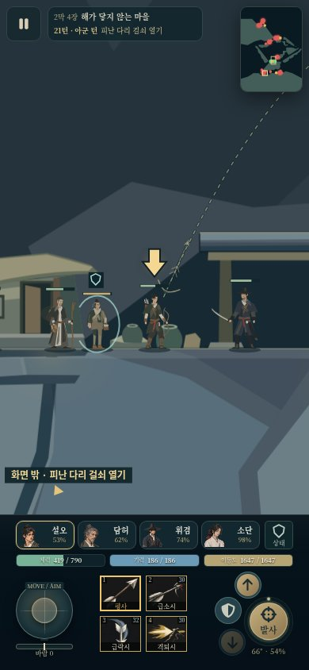

# 14장 중복 처치 gate 제거 후보 · 2026-10-22

**구조는 단축됐지만 전체 장 완주는 미입증이다.** 같은 조건의 한 번 측정에서 세 주민을 R5/R8/R15에 구조했고,20라운드 사용 후 R21 시작의 다리 목표에서 중단했다. 이후 다른 목표를 지우거나 최적 경로로 재실행하지 않았다.

## 소스·생성물·검사 SHA

- 기준 master `1f1b267c2d23bc5975af5841c560e4413291330b`.
- 실제 정상 입력 실행 소스 `853c1a22341a6a295aa83dfb3c4356517c5ae89a`.
- 공통 빌드 생성물 `a03c941d37681449b850de67dc669460bb6be607`.
- 최종 코드/검사 파일 보존 `6824e69f07ef2cc2d78d44e5e42681df1abf04c9`. 853c 이후 shared/game 설정/저작 런타임 소스 변경은 없다. 이후 커밋은 생성물·검사·이 문서다.
- 브랜치 `fix/stage14-rescue-gates-20261022`. master/Pages에는 쓰지 않았다.
- 실제 활성 chapter14 `web/data/chapter-14.aaa3539cdc1e3744.json`, Game entry `web/entries/game.874093a9e07dc27c.js`/`game.dd91ee41b1963fb3.html`.

## 정확한 변경 범위

필수 목표에서 `clear-upper`/`clear-middle`만 제거했다. 현재 순서는 **family-upper → family-mid → family-lower → bridge → hold-refuge → clear-village**다. 세 주민/순서, 주변360 위협, 붙은 혼40% 이하와 소단 분리/다른 동행 완전 제압 선택, NPC 실패, 다리 상호작용, 보호4라운드·유한6증원, 마지막 보호 NPC 반경1050·높이차600의 국소 위협 판정은 보존했다.

지형/17개 저작 경로/미술/배우·적 배치·HP/전역 밸런스는 그대로다. 이전 측정과 초기 배우의 HP·위치·공격·기력·이동도·장착·랭크·XP 예산 및 컴파일된 충돌 지형도 exact 대조했다. 다른29장 canonical 소스와 library는 unchanged다(30장 포함).

부모 확정 guide만 `narrative-current.json`에서 바꿨다:

> 각 층의 주민 곁에 붙은 혼을 약하게 만들고 구조하세요. 광물길과 동쪽 능선은 다른 사격점으로 이어집니다. 다리 걸쇠를 열고 4라운드 보호한 뒤 등잔집 곁의 위협만 제압하면 완료됩니다.

story/beats/outro/summary와 행 ID는 바꾸지 않았다. Stage14 저작 도구도 현재 catalogue의 guide를 읽도록 했으며, 초안 JSON에는14 guide 항목이 없다. 전체 저작 순서를 다시 거쳐도 은퇴 gate가 복원되지 않는다.

`stage14-rescue-gates.js`는 campaign/vertical revision1/알려진8·6개 ID 목록에만 적용한다. 완료 flag를 새로 만들지 않고 필수 목록만 필터링한다. 기존 retired done 이력도 삭제하지 않는다. 동행/적/NPC HP·위치·기력·이동도·턴·경험치·아이템·파동·대사 원문/cursor·보상 ledger는 보존한다. custom/다른 장/미지원 revision·목록/종료 전투는 untouched다.

## 같은 조건의 한 번 비교

입장 plan13.8 = XP42,883/실제 경지13, 보통,4동행, seed/RNG19388. 기존 합법 rank1/능력치 수련6/4슬롯 build와 자동 정책 `authored-fast-descent`/`mobile-local-defense`를 재사용했다. 동행별 수련점15–18이 남는 보수적 build이며 평균/최적 플레이를 대표하지 않는다. 이전13장을 실제 완주/XP 획득했다는 뜻도 아니다.

| 항목 | 이전63cc 측정 | 이번 후보 |
|---|---:|---:|
| 상층 주민 구조 | R9 | R5 |
| 중층 주민 구조 | R17 | R8 |
| 하층 주민 구조 | R21 시작에도 미완료 | R15 |
| R21 시작 목표 | 하층 주민 구조 | 피난 다리 걸쇠 열기 |
| 실제 사용 라운드/동행 턴 | 20/80 | 20/80 |
| 사격·기예/구조/일반 방어 | 67/2/11 | 69/3/8 |
| 네 배우 합산 이동 예산 차감 | 45,883.24 | 45,674.56 |
| 동행 피해/정상 HP회복 | 2110/400 | 1423/351 |
| 전체 완료 | 미완료 | 미완료 |

이동+전투48턴, 제자리 전투21턴, 상호작용3턴, 이동만4턴, 제자리 방어·회복4턴이다. 이동과 공격은 한 턴에 겹치므로 별도 라운드처럼 더하지 않는다. R21은 무입력 종료 상태로 대기·사용 라운드에서 제외했다. 실행 시작 뒤 무적/좌표·HP·기력·이동도 보정/적 삭제·HP 감소/목표 flag 강제 완료는 없었다. 외부 배우 쓰기0/Engine 강제 recover0/경로 실패0이다. 모든 실제 입력은 축약 trace에 보존했다.

### 남은 병목과 controller 한계

R15에 세 구조가 끝났지만 기존 정책은 `bridge` 목표에서도 살아 있는 `east-shoulder`/`lower-house`를 우선 처리한다. 이후 기록 사격20회는 f5/e3/f4/e4/e2/e5/e1을 향했고, 고정 하부 crossfire 위치 선택18건이 있었다. 마지막 R20에도 일행은 가족집 마당에서 위쪽 e1을 사격했다(e1 잔여98/1349HP, x4558/y6210). **이 상부 적은 다리 상호작용 반경360이나 최종 보호 NPC 높이차600 안에 있지 않다.** 이 부분은 controller가 더 많은 전투를 택한 비용이며 게임이 전수 소탕을 요구한 결과가 아니다.

그렇다고 즉시 다리를 열 수 있는 상태라고 주장하지 않는다. R21 실제 다리 주변 필수 위협은 g1(733HP)·g3(473HP) 두 마리이며, 이동/해당 위협/보호4라운드가 남아 있다. 실제 정상 경로의 다리·보호·마지막 국소 정리·보상·15장 진입은 미도달이다. 더 빠른 정책의 완주 턴수/사람 평균/전체 사람 클리어 시간은 측정하지 않았다. 이 첫 비교 뒤 지형이나 다른 목표를 추가 변경하지 않는다.

R21 동행: 설오419/790, 담허526/855, 휘겸1025/1382, 소단984/999HP. 주민739/950·925/950·918/950, 보호 NPC1900/1900으로 전원 생존. 잔적27명·증원0. 구조3건의 혼 처리까지 포함한 적 사망 상태는16명이며 순수 기록 전투 사망은13명이다.

## 실행 검사와 별도 fixture

- `node tests/stage14-rescue-gates.mjs`: source/author idempotency 및 full author chain,29장·지형·배치·경로·현행 prose 경계, 구8단계의 각 prefix0–7 R20 Continue, 반복 export/Continue 전체 전투 exact, 소비 자원/NPC HP/완료 사실 보존, 대사2쪽 원문/cursor·정지, 미지원/종료 제외 PASS. 커밋 후 재검사 SHA a03c941d.
- `node tests/stage14-rescue-retained-boundaries.mjs`: **읽기 전용 predicate fixture**의 다리 선행·주변 위협, 보호0–3/4와 미입장 파동, 국소1050/600 경계, NPC4명 실패 PASS. **미리 완료 상태를 제공한 terminal-save fixture**의 중복 보상 방지→결과→쉼터→15장 진입/정상 새 장 자원→whole-battle Continue PASS. SHA a03c941d에서 실행한 검사 파일은6824e69f에 보존했다. 이 완료 상태/좌표 시나리오는 실행 전 fixture 입력이며 정상 완주 증거가 아니다.
- `HONRO_FULLPLAY_CURRENT_AUDIT=1 HONRO_FULLPLAY_OUT=_local/reports/stage14-rescue-gates-20261022/fullplay node tests/stage14-vertical-fullplay.mjs`: 위853c SHA 한 번 실행, R21 cap에서 종료코드1/validationFailure null. 미완료를 PASS로 바꾸지 않았다.
- `npm run build`, `npm --prefix game run typecheck` PASS. 생성 HTML을 직접 고치지 않았다.
- `python3 tests/stage14-rescue-gates-browser.py`: 390×844 실제 built UI의 새 첫 목표/구 clear-middle R20 Continue/기존 대사2쪽 보존, actor·자원·목표 사실 exact PASS. 실행 SHA853c(생성물 미커밋 상태, 이후a03c에 보존).
- `python3 tests/stage14-rescue-gates-browser.py --fullplay-only`: 실제 측정 종료 profile을 그대로 모바일 Continue, R21/배우·자원 exact, 추가 행동 없이 캡처 PASS. 실행 SHAa03c. 브라우저 JS·HTTP 오류0.

전체 verify/30장 완주/옛 긴 검사 재실행/추가 최적 경로 측정/미술 검수는 하지 않았다. 저장 fixture는 실제 미확인 사용자 저장을 대신하지 않는다.

## 실제 JPG와 공개 자산 보존

아래4장을 직접 열어 현재 목표, 구 저장의 목표 연결, 대사 cursor, 실제 측정 종료 위치를 확인했다. 모두1MB 미만, 로컬 공통 빌드의 실제 브라우저 캡처이며 Pages가 아니다.

- [새 첫 목표](fresh-family-upper-390x844.jpg)
- [구 clear-middle R20 Continue](round20-middle-continue-390x844.jpg)
- [기존 주민 대사2쪽](round20-dialogue-page2-390x844.jpg)
- [실제 정상 입력 R21 종료 상태](measured-r21-bridge-390x844.jpg)

빌드 전에 `tests/fixtures/published-web-history-20261022.json`에 부모가 확인한1f1b267/Pages39815535010/2026-10-22T16:46:17Z 성공을 추가하고 retain-published-web의 실제7일 이력을 등록했다. 그래프 중복 제거 후 보호6그래프이며, 이전 최신 활성 그래프와 보호된 전체 immutable437파일의 존재/길이/SHA256이 빌드 뒤 exact다. 삭제/변조0, 후보를 성공 발행으로 등록하지 않았다.

[evidence.json](evidence.json)에 provenance/실제 입력·탄별 피해/round state/검사·보존·캡처 SHA256을 보존했다. raw 전체는 `_local/reports/stage14-rescue-gates-20261022/`, 이전 비교 근거는 [기존 진단](../stage14-current-pacing-20261022/README.md)이다. 최종 인계 커밋은 이 문서의 Git 이력과 부모 최종 응답에서 확인한다.
