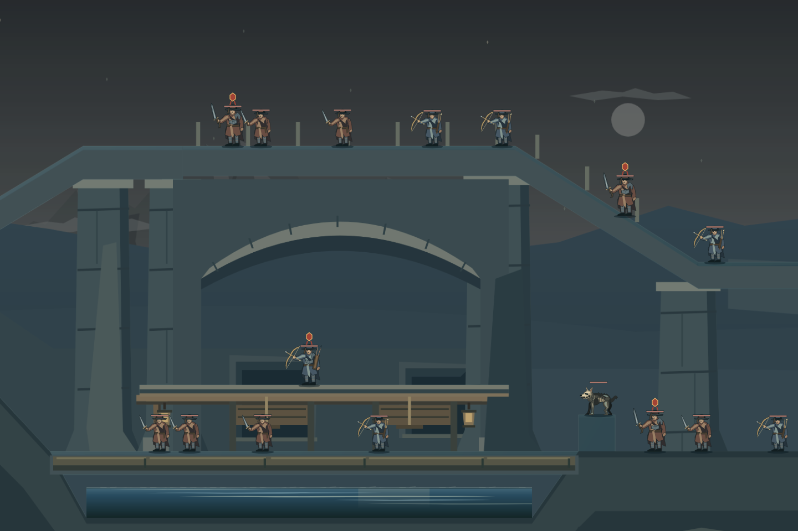
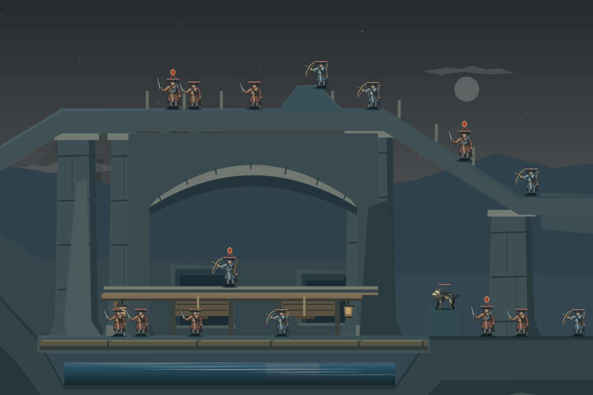

# 29장 지형 후속

기준 master `de286f945376553e159c5f4c8a4a9d5063b3e4a3`. 21–30장 의도와 현 지형을 대조한 뒤 상층 수문길의 부족한 실체 엄폐만 수정했다. [장별 보존 결정·설계·한계](../../game/docs/plans/2026-10-20-act3-terrain-continuation.md).

| 변경 전 | 변경 후 |
|---|---|
|  |  |

같은 현재 production Native Scene, 카메라 x5200/y2200/scale0.6. 정상 플레이 화면이나 미술 전면 개편 판정이 아닌 지형 비교 캡처다. 기존 상층 polygon 윗면에 높이95 정비 받침을 만들고 그 위 사수 한 체의 발 Y를 맞췄다. 하층과 두 출구·목표/이벤트/대사·27명/정예7·전력/XP·유한 증원은 보존했다.

`node tests/stage29-service-cover.mjs` 통과: 같은 M01 실탄 전130/후0 피해, 받침 위 실탄148 피해, 양방향 기본 보행(점프0·피해0), 실제 이동 뒤 기존 상층 A 출구 선택, revision1 전투 폐기/29장 revision2 재생성과 성장·장착·진도 보존. 시작 위치·단독 적·이전 목표 완료는 명시 fixture다. 전후 렌더는 전투 상태를 바꾸지 않았다.

공통 App 테스트 도구는 최신 App 시작 hook과 맞지 않아 실행되지 않았다. 이후 실제 production Chromium에서 localStorage의 revision1 기록을 새로 불러와 전투 폐기와 29장 입구 재시작, 성장·장착·진도 보존을 확인했다. 새 번들의 29장 진입, 수정 사수의 원본 좌표/몸 접점, 새 받침 실제 횡단도 통과했고 pageerror는 없었다. 정상 완주·나머지9장 재플레이·전체 verify·전 장 미술 검수는 미실행이다.

`npm run build` 성공(활성 파일231개). 구현 커밋은 `ba46924f08849979730c9f3bef63d1ce20352080`이며 별도 브랜치 원격 반영을 확인했다. 최신 master `ff790dc5`의 1–20장 지형 보존 기록을 유지해 통합했다. 최종 master/Pages 실행 상태는 작업 결과 응답에 별도로 기록한다.
