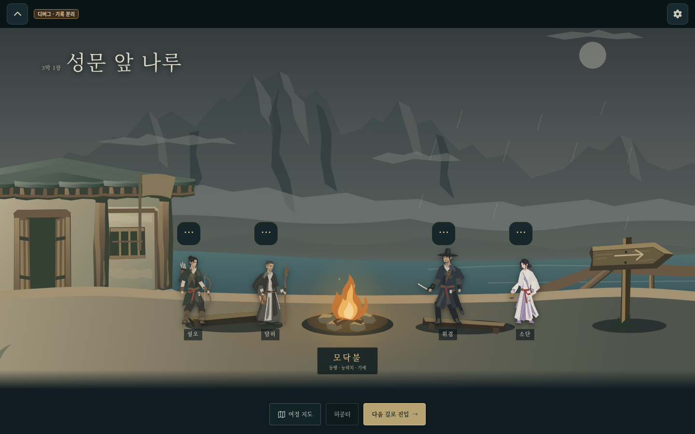
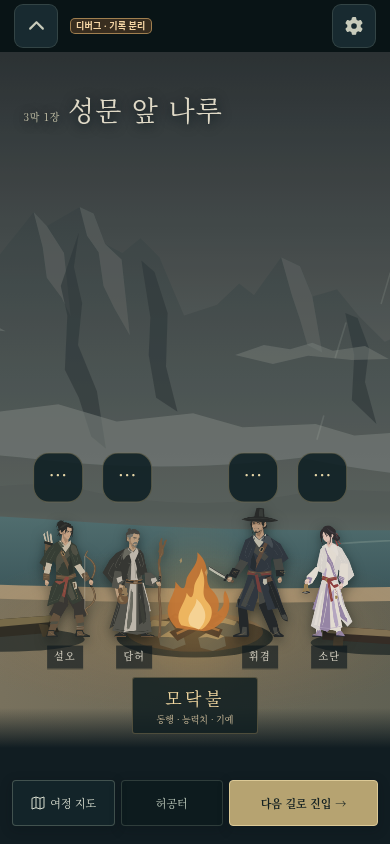

# 휴식터 공통 벡터 통합 캡처

2026-10-20, 로딩 개선 master `2014aa4c57c4a4deb579863fdea87cfb7c08f2d1`에 휴식터 소스 `c3f1bd35de6f209f5f51722e41defcab27b85f6c`만 통합한 빌드다. Library 첨부는 업로드 도구 연결의 네트워크 오류로 생성 전에 실패하여, 부모가 승인한 저장소 캡처 대안을 사용했다.

대표 장소는 21장 **성문 앞 나루**다. 실제 Chromium에서 PC 1440×900, 모바일 390×844의 기본 렌더·인물 canvas 4개·모닥불·1600×900 SVG와 pageerror 0만 확인했다. 기존 pan/zoom/진입 검사를 반복하거나 다른 담당 브랜치를 병합하지 않았다. 사용자 진행 저장과 무관한 디버그 프로필이다.

[PC 원본](pc.png) · [모바일 원본](mobile.png) · [기본 렌더 결과](render.json)

