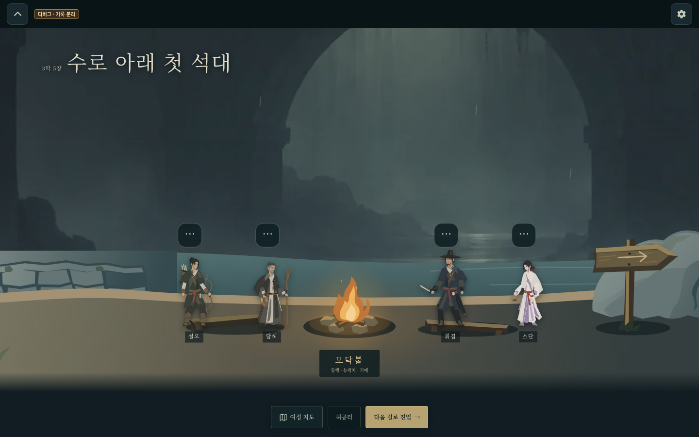
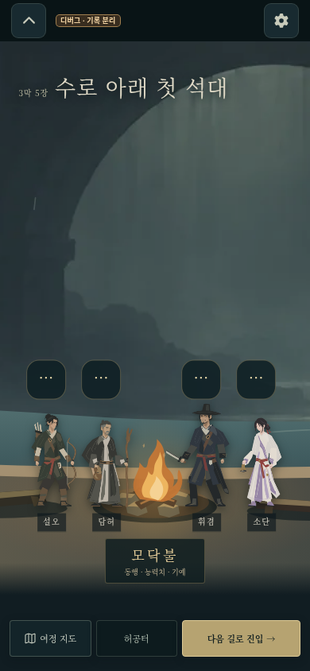

# 휴식터 래스터 원경 교정 — 검토용 캡처

기준: `25071f2a20f0695e9260408394fa5ef3c9e76c43`. 기존 캡처는 기능 연결 확인용이었고, 선명한 벡터 산맥 원경은 부모 미술 검토에서 불합격했다. 아래는 그 후속 교정이며 최종 미술 승인을 뜻하지 않는다. 현재 브랜치의 소스만 별도 통합 대기한다.

기존 그림을 직접 보고 21장 **성문 앞 나루**에는 `location-far/source/town-wall.png`, 동굴 대표 25장 **수로 아래 첫 석대**에는 `underground-channel.png`를 재사용했다. 원본을 변경하지 않고 2048px WebP로 인코딩했다. 원경은 독립 외부 래스터 한 장이며 정적 회색 색막으로 대비를 낮춘다. 실시간 filter, SVG 산맥, 추가 미세 디테일, 새 이미지 생성은 없다.

21장 근경 건축을 같은 1600×900 공간 안에서 오른쪽으로 340 이동해 모바일 첫 프레임에도 처마/창/기둥 일부가 보인다(가시 폭 약 170px). 인물 canvas의 크기·좌표, ground765, 카메라·버튼 CSS/클릭 처리는 변경하지 않았다.

실제 Chromium PC 1440×900, 모바일 390×844에서 두 장소만 확인했다. 원경 WebP decode·독립 pan·21장 건축 가시성·기존 모닥불/진입 버튼·pageerror0을 확인했다. 시작 시 이 원경 요청은 0개이고 장소를 연 뒤 해당 그림만 요청된다. 나머지 28곳은 데이터 매핑만 확인했다.

[21장 PC](pc.png) · [21장 모바일](mobile.png) · [25장 PC](cave-pc.png) · [25장 모바일](cave-mobile.png) · [최소 확인 결과](render.json)

